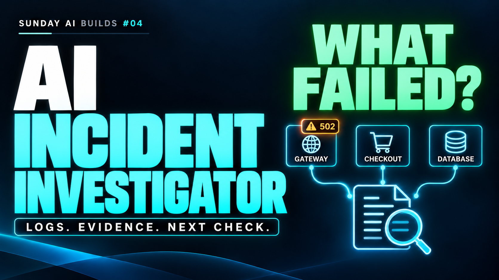
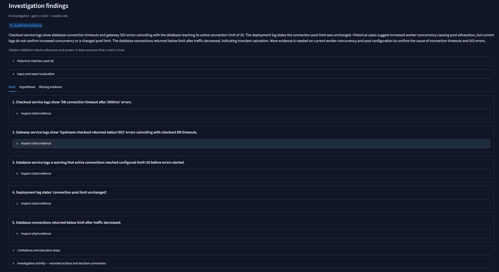
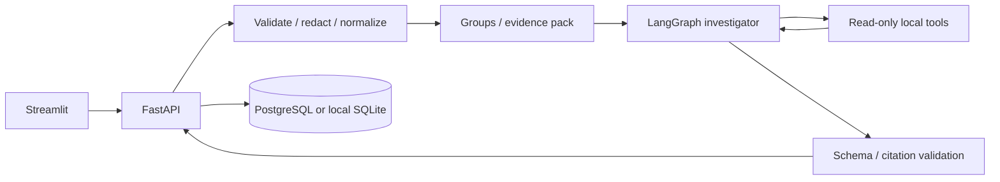
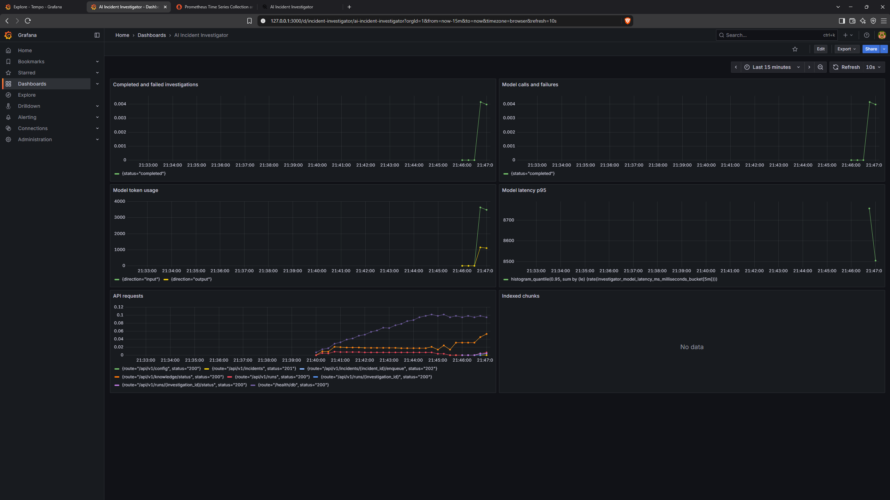

# AI Incident Investigator

[](https://youtu.be/kpTkvtlfvfY)

[](https://youtu.be/kpTkvtlfvfY)
[](https://www.linkedin.com/in/w-e-ll/)

[Watch the full project walkthrough, Sunday AI Builds #04](https://youtu.be/kpTkvtlfvfY)

Sunday AI Builds #04. An investigation workbench for an engineer's first pass through an incident.

Upload logs, inspect repeated errors, and generate a report with event references and exact quotations. The application keeps observed facts, hypotheses, and missing evidence separate. Historical cases help choose the next check. Background jobs save results so the work can be reopened after a browser refresh.

The recorded example follows checkout failures and database connection timeouts. Its saved report concludes that evidence is insufficient to confirm the trigger. Citation validation checks references and quotes, but it does not establish causality.



## Video walkthrough

The [video walkthrough](https://youtu.be/kpTkvtlfvfY) covers one synthetic incident, a real model request, evidence review, historical retrieval, background recovery, usage, and application observability.

Python 3.13 · FastAPI · Streamlit · LangGraph · LangChain OpenAI · Pydantic · SQLAlchemy · PostgreSQL / SQLite · uv

## What works

- UTF-8 JSONL and a documented text-log format, maximum 2 MiB / 10,000 physical lines.
- Redacted source excerpts with stable evidence IDs and physical line ranges.
- Error fingerprints scoped by service and severity; counts and first/last timestamps.
- Interactive timeline, error-group drilldown, literal search, and evidence explorer.
- Free **demo** mode: deterministic conservative templates, explicitly not LLM reasoning.
- **Live** mode: a single investigator in a bounded LangGraph loop with four read-only tools.
- AI mode is the default, with explicit setup instructions when the backend key is absent. Key presence is not proof of provider access.
- Live activity streams actual model requests, decision summaries, tool queries/results and citation checks; activity is saved with the report.
- Strict report contracts, exact quote checking, seen-evidence validation, qualitative support, alternatives, and diagnostic next checks.
- Persistent investigations, run history, JSON export, local operational monitoring, token usage and context-size estimates.

Live output can still be wrong. Citation integrity does not establish truth or causality. A valid outcome is **insufficient evidence**.

## Quick start: Windows / PyCharm

Open a terminal in this project directory. Your existing PyCharm `.venv` is preserved.

```powershell
uv sync --frozen
uv run python scripts/setup_env.py
```

Start the backend in one terminal:

```powershell
uv run uvicorn api.main:app --host 127.0.0.1 --port 8000
```

Start the UI in a second terminal:

```powershell
uv run streamlit run streamlit_app.py --server.address 127.0.0.1 --server.port 8501
```

Open [the workbench](http://127.0.0.1:8501), click **Load sample**, select **Demo** in the investigation mode control, and click **Investigate**. AI mode is the default. Demo needs no API key and makes no model requests. API documentation: [Swagger UI](http://127.0.0.1:8000/docs).

Alternatively, use `./scripts/run.ps1 Setup`, then `./scripts/run.ps1 Api` and `./scripts/run.ps1 Ui` in separate terminals. Setup preserves an existing `.env`.

## Try the scenarios

| Sample | Investigation objective |
|---|---|
| `samples/db_timeout.jsonl` | Dependency capacity symptoms and an API error cascade; deployment timing alone is not proof |
| `samples/config_change.jsonl` | Credential mismatch, configuration change, and rollback evidence |
| `samples/independent_failures.jsonl` | Preserve multiple independent explanations |
| `samples/insufficient.jsonl` | Abstain and request missing upstream context |
| `samples/sample.log` | Text parsing with an indented stack trace |

All samples are synthetic. `samples/ground_truth.json` contains a qualitative evaluation rubric, not measured live-model accuracy.

JSONL fields: `message` (required non-empty string), `timestamp` (ISO-8601), `level`, `service`, `trace_id`, `request_id`. Structured kind, attributes, and duration_ms are retained in normalized evidence; other fields remain in redacted source excerpts. Missing or timezone-less timestamps are excluded from chronological display. Invalid records are counted; the first 50 issues are listed.

```json
{"timestamp":"2026-10-06T12:00:00Z","level":"ERROR","service":"checkout","message":"DB connection timeout","trace_id":"checkout-1"}
```

Text format:

```text
2026-10-06T12:00:00Z ERROR checkout DB connection timeout
    TimeoutError: pool exhausted
```

## Live investigation

Set `OPENAI_API_KEY` in backend `.env`. `INVESTIGATION_MODEL` defaults to `gpt-4.1-mini`, which supports structured output according to the [official model documentation](https://developers.openai.com/api/docs/models/gpt-4.1-mini). The adapter uses LangChain's JSON-schema output and Pydantic validation; [structured outputs](https://developers.openai.com/api/docs/guides/structured-outputs) constrain shape, not factual correctness.

The UI requires reviewing the upload before sending redacted evidence to the configured provider. Redaction is best-effort, not a comprehensive secret/PII detector. Never upload data you cannot share with that provider. Credentials remain in the backend.

Default limits: 3 model calls, 4 tool calls, 20 returned events per tool, 60 initial evidence events, cumulative estimated input guard of 16,000 tokens, 2,000 output tokens per call, and a 30-second provider timeout. No automatic provider retries, output repair loop, or fallback model. An ambiguous provider failure may still be billable. See [live investigation details](docs/live-investigation.md).

Configure `INPUT_USD_PER_MILLION`, `OUTPUT_USD_PER_MILLION`, and `PRICE_AS_OF` for the exact model to obtain an estimated usage cost. A published default for gpt-4.1-mini is bundled: $0.40 input and $1.60 output per million tokens, checked 2026-10-08. Other models require explicit rates. Missing usage/prices means **unknown cost**. Cached-token discounts, embedding charges, and invoices are not included in the investigation estimate.

## Architecture



The UI uses HTTP only. All model calls and database writes belong to the backend. See [architecture](docs/architecture.md) and [decisions](DECISIONS.md).

## Storage and Docker

For immediate local use, `DATABASE_URL=sqlite:///var/incidents.db` creates a SQLite database automatically. This is an explicit development fallback. PostgreSQL is the Compose path and uses Alembic migrations.

Docker Desktop must have its Linux engine running. Setup generates separate strong, URL-safe `POSTGRES_ADMIN_PASSWORD` and `APP_DB_PASSWORD` values in ignored `.env` without printing them; existing values are preserved. Then:

```powershell
uv run python scripts/setup_env.py
./scripts/run.ps1 DockerUp
docker compose logs --tail 100 api
docker compose down
```

To build and run the full test suite including isolated PostgreSQL verification: `./scripts/run.ps1 DockerVerify`.

`down` preserves the named PostgreSQL volume. The app connects as a non-superuser; migration and runtime currently share that role. Do not use `down -v` as troubleshooting. See [Docker operations](docs/docker.md).

## Monitoring, cost, and optimization



The screenshot shows later verification activity. Its cumulative metrics are separate from the saved report's per-run usage.

Start the application with `./scripts/run.ps1 DockerUp`, then run `./scripts/run.ps1 ObservabilityUp`. The second command recreates API and worker with the OpenTelemetry export endpoint. Grafana opens at http://127.0.0.1:3000 and Prometheus at http://127.0.0.1:9090. Inspect Tempo through Grafana Explore with the Tempo data source.

If a later `DockerUp` recreates API or worker without the observability overlay, run `ObservabilityUp` again. Monitoring containers can remain running while application export is disabled. Generate HTTP activity with Check dependencies and wait about 30 seconds. Check `up` and `sum(investigator_http_requests_total)` in Prometheus before making a paid model request. Model metrics require a new call after export is enabled. Previously saved runs do not backfill counters.

- **Monitoring:** health and DB checks, latest 100 run statuses, sample-scoped failure denominator and completed-run p95. The UI displays the observed window. The optional Grafana/Prometheus/Tempo stack receives OpenTelemetry API/database traces and business metrics; external uptime checks and alert policies are not included.
- **Cost:** per-call token usage and latency, optional model price snapshot, unknown-cost handling, no paid calls in demo.
- **Optimization:** compare tokenizer-estimated full redacted logs with the initial evidence pack. Overhead can make the pack larger on small files; negative reductions are shown. This is not measured dollar savings or an accuracy claim. Evaluate quality before changing selection limits.

## Checks

```powershell
uv run ruff check .
uv run ruff format --check .
uv run pytest -q
```

Tests use isolated SQLite files and a mocked model by default. The Streamlit test exercises sample upload → investigation → history through an in-process API. PostgreSQL tests require an explicitly named isolated test database; see [verification](docs/verification.md). No tests send paid provider requests.

## Project map and maintenance

```text
api/                 HTTP contracts, lifecycle and safe errors
core/                parsing, evidence, schemas, graph, settings, logging
db/                  schema and transactional repository
ui/                  HTTP client and report/dashboard views
streamlit_app.py     workbench entrypoint
samples/             synthetic fixtures and ground-truth rubric
tests/               domain, API, repository, logging and UI verification
migrations/          versioned database schema
scripts/             Windows commands and fixture generator
docs/                architecture, logging, live runs, operations and verification
```

Detailed [file map](docs/project-files.md), [logging](docs/logging.md), and [changelog](CHANGELOG.md).

## Current boundaries

This is a local application with tenant-scoped storage and retrieval, but no authentication: X-Tenant-ID is a routing boundary, not trusted identity. Do not expose it publicly without authentication and authorization. PostgreSQL provides pgvector search; SQLite is a lexical development fallback. Queued investigations survive restarts; LangGraph execution within a started job is in memory and is not replayed after an ambiguous paid failure. Inactive started runs can be explicitly abandoned after 15 minutes, then reviewed before a new run ID. UUID reservation does not guarantee exactly-once provider billing. Raw files are not retained separately; redacted excerpts are persisted. No retention scheduler or external alerts are implemented.


Knowledge base workflow: [docs/knowledge-base.md](docs/knowledge-base.md).

## Historical incidents and background jobs

Open **Knowledge base**, choose a resolved-case sample or upload JSON, preview the sections, and save them to the indexing queue. Review the data before indexing: embedding calls are paid. Search uses tenant and optional service/environment filters; PostgreSQL combines full-text and vector candidates with reciprocal rank fusion. Historical matches accompany the current evidence and remain hypotheses, not facts about this incident. No cross-encoder reranker is implemented.

The **Investigate** workspace includes `production_trace_incident.json`: correlated spans, metrics, deployment/rollback, Kubernetes health, and alert records. Use service/environment filters to scope historical matches. Select **Run as a durable background job** and use **Check pending job** to retrieve progress/results. For local execution, start `uv run python worker.py` in a third terminal; Compose starts it automatically.

Run `./scripts/run.ps1 ObservabilityUp` to enable the collector and recreate API/worker with the export endpoint. Grafana is at http://127.0.0.1:3000. Logs rotate in `var/logs/<service>/<python_file>.log` alongside service aggregate logs. Offline contract evaluation: `uv run python -m scripts.evaluate`; it does not measure live model accuracy.

## Communication and live verification

Project messaging and the live verification checklist are in [docs/communication](docs/communication/mvp-status-and-live-test.md). The [current verification summary](docs/verification.md#publication-verification) distinguishes offline checks, user-run Docker tests, observed live runs, and limits on model-quality claims.
