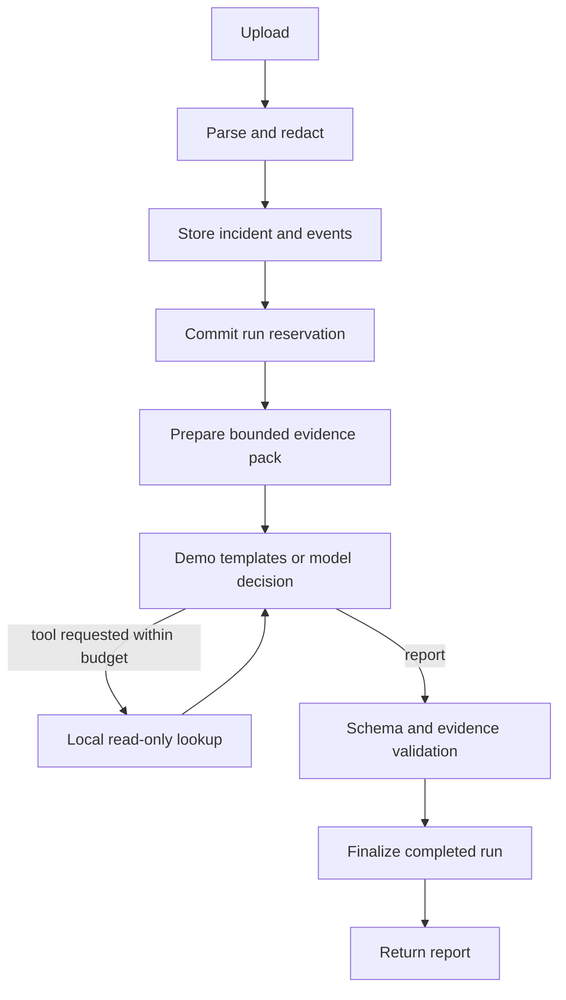

# Architecture

The business flow is upload → validation/redaction → normalization → persistent incident → reserved run → bounded investigation → citation validation → persistent report → HTTP/UI result.

## Sources of truth

- Normalized events and their redacted source excerpts are the evidence source for an uploaded incident.
- Error counts and timestamps are computed by Python over accepted events, not generated by the model.
- Reports are interpretations of that evidence. Model output is not the source of truth for event counts.
- The database owns incident/run identities and status. Demo and live reports share contracts but keep explicit mode labels.

## Components and boundaries

Streamlit calls FastAPI over HTTP; it has neither a DB connection nor a provider key. FastAPI validates input/output contracts, owns error translation and external effects. Core parsers and evidence functions are independently testable. SQLAlchemy Core owns transactions. LangGraph combines deterministic preparation/validation with a bounded model-driven tool loop.

The report contract is facts / hypotheses / missing evidence, plus explicit limitations. A probable cause requires a strongly supported selected hypothesis. This is a structural gate, not independent assessment of whether the support merits that label. Quotes must match normalized messages; all live references must have been shown to the investigator. The UI warns that citation integrity does not establish semantic truth.

## Data lifecycle

| Table | Purpose | Writer / lifecycle |
|---|---|---|
| `incidents` | Upload identity, safe display name, creation time, parse metadata | Repository writes once after validation |
| `events` | Normalized events with redacted physical-line provenance | Inserted atomically with incident; scoped IDs prevent cross-upload collisions |
| `investigation_runs` | Reserved UUID, started/completed/failed status, config, report or failure metrics | Repository reserves before model call and finalizes only from started |

JSON columns contain strict domain snapshots; indexed typed columns contain identities and lifecycle fields. No raw upload file is retained. Source excerpts may still contain sensitive data missed by best-effort redaction. Uploads and reports are retained until the operator manages the local database; automatic retention is future work.

SQLite initializes tables for the local fallback. PostgreSQL schema is created via Alembic. Migration/runtime share a non-superuser app role in Compose. Separating privileges is future work. Transactions never span provider calls. Successful persistence events are emitted after commit.

## Failure semantics

Invalid upload → safe 422/413 and no incident. Model/schema/citation failure → failed run with known usage recorded. Unknown usage stays unknown. A DB failure after a provider call can leave a started run; no automatic replay or recovery claims. Graph execution is synchronous per HTTP request in a worker thread, bounded by calls and per-call timeouts. It has no durable checkpoint backend.

## Next work tied to evidence

First evaluate live reports against the four fixture mechanisms, checking unsupported claims, abstention, evidence relevance, and alternatives. Add a durable worker only when long runs/concurrency require it; add integrations only when uploaded evidence cannot answer the target investigation questions. No vector store is needed for bounded exact lookup over a small upload.

## Implementation update, 2026-10-08

A PostgreSQL-backed worker now claims queued investigations atomically and persists public progress. LangGraph runs inside each claimed job; no mid-node checkpoint resume or automatic replay of started paid jobs is implemented. Tenant headers scope incident/run/knowledge reads and writes, but are not authentication. Knowledge ingestion is available in the UI, with explicit embedding indexing and failed-item requeue. PostgreSQL search fuses lexical and pgvector candidates with RRF and metadata filters. Automatic historical retrieval uses the symptom or error fingerprints; historical material remains separate from current incident facts. Schema/citation evaluation is persisted, while semantic correctness remains unverified. See README and project-template.md for operational details and boundaries.
